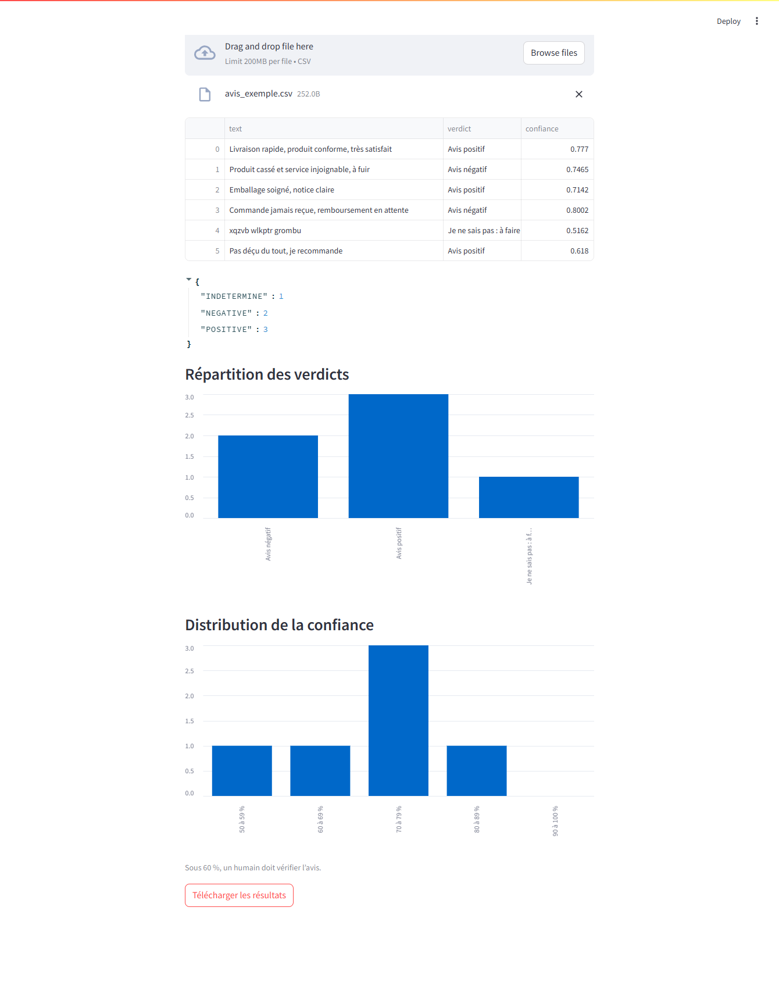

# Compte rendu du projet sentiment-app

## Atelier 0 et TP1

Les fiches de cadrage sont dans [docs/cadrage](cadrage). Python 3.11 exécute le modèle et les tests dans un environnement virtuel. Le jeu de démonstration contient 290 avis synthétiques. Sur les 58 avis du jeu de test, le F1 macro est de 0,879 pour un seuil de 0,85.

La séparation des données précède l’apprentissage du vocabulaire TF-IDF pour éviter que le modèle voie les données de test à l’entraînement. Le pipeline sauvegarde ensemble le vectoriseur et le classifieur, ce qui garantit la même transformation pendant l’entraînement et à la prédiction. Une réponse HTTP 200 confirme l’exécution de la requête. Un avis ambigu peut néanmoins être mal classé, comme l’illustrent les erreurs connues du [jeu d’or](../data/jeu_or.csv).

## TP2

`GET /v1/health` indique si l’API est prête. `POST /v1/predict` accepte une clé client ou administrateur. `GET /v1/modele` est réservé à l’administrateur et expose le seuil de 0,60 et les métriques. Les tests vérifient notamment les statuts 401, 403, 422 et 503 et le format d’erreur versionné.

Le prévol CORS est autorisé sur le port 5500. Sur le port 5600, le navigateur bloque la requête après le refus du prévol. Un client en ligne de commande comme curl n’applique pas la politique CORS du navigateur. L’authentification côté API s’applique dans les deux cas.

## TP3

Sur six avis, trois sont positifs, deux sont négatifs et un est renvoyé à un humain. Le graphique de confiance place cet avis dans la tranche de 50 à 59 % (51,62 %), sous le seuil d’abstention. Les cinq autres scores vont de 61,80 % à 80,02 %, ce qui montre que la confiance varie sensiblement même parmi les avis classés.

Streamlit passe par l’API, ce qui permet de réentraîner le modèle sans changer l’interface. Si l’API est injoignable, la page propose de lancer Uvicorn. Le CSV téléchargé contient les six résultats.

## TP4

La roue et la distribution source embarquent le modèle de démonstration. La roue s’installe avec pip et expose la fonction `sentiment_app.predict` et la commande `sentiment`. Le script `scripts/verifier_livrable.py` contrôle les archives et rejoue les tests dans un environnement neuf. L’activité Java est disponible dans `java/avis-service`.
